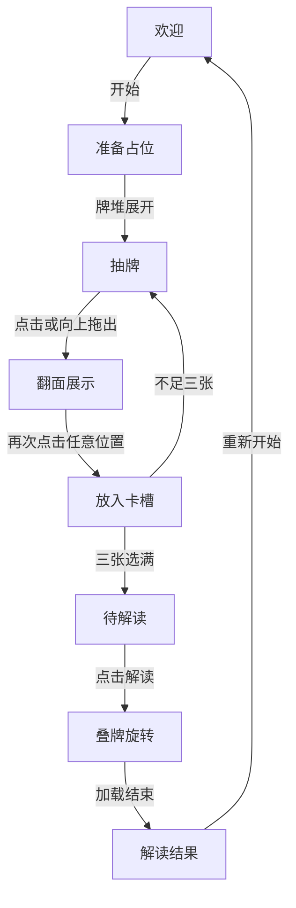

# Tarot 页面功能规范

Tarot 是展示完整抽牌流程和交互效果的示例页面，入口为 `/tarot`。本文约定开发和重建时保留的功能与体验，源码、技术方案和视觉设计可自由调整。

## 流程图

## 欢迎与准备

欢迎界面居中显示三个扇形牌背，下方依次是欢迎语和开始按钮。开始后短暂显示静止牌堆作为准备动画占位，再自动展开进入抽牌界面。

## 抽牌

上方是三个卡槽，下方是牌背朝上的横向重叠牌列。每轮随机排列，轮内顺序固定，支持左右按钮浏览，悬停时目标牌抬起、邻牌让开。

鼠标位于牌列区域时，纵向滚轮输入映射为横向滚动。左右边缘使用 Edge fade 渐隐遮罩，仅在对应方向仍可滚动时显示，到达边界后消失。

点击或向上拖出卡牌均进入展示，触摸横向滑动用于浏览。拖动时卡牌跟随指针或手指，未完成拖出时松手回位。

## 展示与入槽

抽出的牌翻面放大，配合全屏半透明模糊蒙版展示，并支持随鼠标位置倾斜的 3D tilt。展示就绪后再次点击任意位置，卡牌按选择顺序移入下一个卡槽。

抽出后始终保持牌面，不能放回、撤回或重复选择。第三张入槽完成后，自动进入待解读界面。

## 解读

待解读界面并排显示三张牌和解读按钮。点击后，三张牌保持牌面朝向用户，叠成一摞在屏幕平面内持续旋转，直到模拟加载结束。

## 结果

三张牌按选择顺序向下展开，每张牌右侧显示对应解读，手机端改为牌上文下。结果页可纵向滚动，末尾的重新开始按钮清空本轮选择并返回欢迎界面。

## 整体约定

卡槽用 `1`、`2`、`3` 表示选择顺序，欢迎语和解读正文用 lorem 占位，操作按钮保留明确名称。解读使用短暂等待模拟，无需外部服务。

动画保留牌堆展开、抽出翻面、入槽、聚拢旋转和结果展开的连续关系，让用户能追踪同一张牌。过渡期间忽略重复操作，抽牌与确认入槽保持为两个独立动作。

以桌面鼠标体验为主，触摸和键盘也能完成全流程，并适配减少动态效果的偏好。
