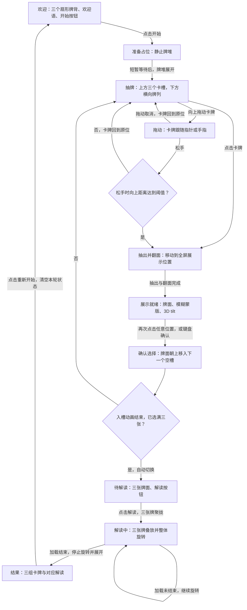

# Tarot 页面功能规范

## 目标与适用范围

Tarot 是一个展示完整抽牌流程和交互效果的示例页面，入口为 `/tarot`。用户从欢迎界面开始，选择三张牌，经过模拟解读后查看结果。

本文是开发、修改和从头重建页面的功能依据。阅读本文即可确定页面行为，无需读取原源码或还原原设计。现有代码是早期实现，发生冲突时以本文为准。

阶段顺序、选择规则、卡牌移动关系和操作方式是固定约束。技术栈、组件结构、图片素材、配色、字体、尺寸、动画时长和缓动可以调整，但须满足本文的交互规则与验收条件。

## 内容与一轮体验

一轮体验从欢迎界面开始，到结果界面结束。页面使用以下内容约定。

- 牌组包含至少三张不同的牌。每张牌有稳定标识、可区分的牌面和统一牌背。牌组大小可调整，完整示例须能展示牌列的横向浏览。
- 每轮开始时随机排列牌组。轮内保持相对顺序，抽牌和界面切换不会重新洗牌。
- 三个卡槽依次标记为 `1`、`2`、`3`，表示选择顺序。标记不附加过去、现在、未来的含义。
- 欢迎语和解读正文使用 lorem 占位。开始、解读、重新开始和无障碍操作名称使用明确文案。
- 解读使用固定的短暂等待模拟加载，结果使用预设占位正文。完整流程无需外部解读服务。

## 流程图

图中实线表示阶段转换，解读中的自循环表示等待期间持续播放动画。

## 阶段与交互

### 欢迎与准备

欢迎界面居中显示三个牌背，按扇形排布。其下依次显示一句 lorem 欢迎语和 **开始** 按钮。三个牌背是欢迎画面，不代表已经选牌。

点击 **开始** 后进入准备阶段，短暂显示静止牌堆，再自动展开为抽牌界面的牌列。准备动画当前只保留阶段和接入位置，不制作具体效果。占位阶段自动结束，不要求用户再次操作。

### 浏览牌列

抽牌界面上方显示三个卡槽，下方显示横向重叠的牌列。尚未抽出的牌只显示牌背。

牌列支持横向滚动和左右按钮。到达某一侧边界后，对应方向的按钮隐藏或禁用。牌列中的所有牌都可通过浏览操作到达。

鼠标悬停时，目标牌抬起，邻牌向两侧让开。移出后恢复。手机和键盘操作不依赖悬停效果。

### 点击与拖出

点击一张牌会直接抽出该牌。拖出使用以下判定。

- 向上拖动时，目标牌跟随指针或手指。
- 松手时，向上位移达到阈值才完成抽出。阈值由实现确定，须能区分轻微移动与明确拖出。
- 位移不足时松手，或拖动在松手前被取消，目标牌回到原位。本次操作尚未抽牌，不占用卡槽。
- 触摸屏上的横向滑动用于浏览牌列，不触发抽牌。

点击与成功拖出进入相同的展示阶段。抽出的牌从可选牌列中移除，其余牌保持相对顺序。一次只有一张牌处于展示或入槽过程。

### 全屏展示与确认

抽出的牌从原位置移动到全屏展示位置，并翻至牌面。牌后出现覆盖整个页面的半透明模糊蒙版，背景牌列和卡槽不能操作。

展示就绪后，牌支持 3D tilt，即根据鼠标在牌内的位置产生透视倾斜。鼠标离开后，牌恢复默认姿态。触摸和键盘用户可直接确认，无需触发倾斜效果。

点击卡牌或蒙版上的任意位置都会确认选择。卡牌随后保持牌面朝上，移入下一个空槽。抽出的牌不能放回，展示阶段没有取消操作，`Esc` 不撤回卡牌。

抽牌与确认是两个独立动作。抽牌点击、拖拽结束的松手，以及松手产生的点击，都不能直接确认入槽。只有展示就绪后的新操作可以确认。

### 入槽与待解读

卡牌按选择顺序进入卡槽 `1`、`2`、`3`。已入槽的牌保持牌面朝上，不能撤回或换位，同一张牌不能重复选择。

前两张牌入槽完成后，蒙版消失，用户继续浏览和抽牌。第三张牌入槽动画结束后，页面自动进入待解读阶段。

待解读界面并排展示三张已选牌和 **解读** 按钮。窄屏可以缩小牌和间距，以保持顺序清楚、按钮可操作。该阶段不再提供抽牌操作。

### 解读中

点击 **解读** 后，三张牌保持牌面朝向用户，叠成一摞。整摞牌在屏幕平面内持续旋转，直到模拟加载结束。

旋转动画循环播放，加载完成事件决定何时离开本阶段。模拟等待的具体时长可调整，须让用户能够辨认解读中的状态。

加载结束后，整摞牌停止旋转，三张牌分别移动到结果位置，再显示对应正文。卡牌保留已有牌面，不重复翻牌。

### 结果与重新开始

结果界面按 `1`、`2`、`3` 的选择顺序，纵向排列三组内容。每组包含一张已选牌及对应的 lorem 解读正文。

桌面端每组左侧放牌，右侧放正文。窄屏改为上方放牌，下方放正文。结果界面支持纵向滚动，正文长度不会遮挡其他结果或操作按钮。

**重新开始** 按钮仅出现在结果界面，位于第三组内容之后。点击后清空已选牌和本轮解读状态，结束本轮动画及等待，并回到欢迎界面。下一轮重新随机排列牌组。

## 动画与输入规则

### 卡牌的连续关系

正常动态效果下，各阶段描述的移动过程须能让用户追踪同一张牌。具体轨迹、错开时间和缓动可调整。卡牌移动期间，牌面内容、身份和目标卡槽保持一致。界面切换不会出现多张可操作的同一卡牌。

### 输入时序

一次只处理一个改变流程状态的动作。抽出、翻面、入槽及阶段切换期间，重复输入被忽略，不排队，也不在动画结束后补执行。

阶段就绪才开放对应操作。待解读前不能启动解读，结果出现前不能重新开始。动画完成或被中断后，页面须落到明确的阶段，恢复该阶段允许的操作，不能永久停在不可操作状态。

### 键盘、触摸与减少动态效果

鼠标是主要展示方式，键盘和触摸均可完成整轮流程。

- 键盘焦点可到达操作按钮和未选卡牌，焦点状态可见。聚焦牌列中的卡牌时，该牌进入可视区域。
- `Enter` 或空格可激活聚焦的按钮或卡牌。全屏展示就绪后，焦点进入展示层，同样使用 `Enter` 或空格确认入槽。
- 全屏展示期间，焦点不会进入背景控件。入槽或切换阶段后，焦点移到当前阶段的可操作位置。
- 触摸点击与鼠标点击使用相同规则。拖出与横向浏览按[点击与拖出](#点击与拖出)中的手势规则区分。
- 启用减少动态效果时，短暂淡入淡出替代位移、翻转、倾斜和持续旋转。解读中保留静态等待提示，阶段顺序、确认动作和结果不变。

## 验收条件

以下场景全部满足后，页面才符合本规范。检查覆盖完整流程和输入边界，不要求复现原实现的截图。

| 场景 | 通过条件 |
| --- | --- |
| 初次进入 | 欢迎画面、lorem 欢迎语和开始按钮可见，三个牌背呈扇形。 |
| 开始一轮 | 静止牌堆占位能自动结束，随后展开进入可操作的抽牌界面。 |
| 浏览牌列 | 横向滚动和左右按钮能访问两端的牌，边界按钮状态正确，悬停效果不改变牌序。 |
| 点击抽牌 | 所点的牌翻面进入全屏展示，原点击不会使其直接入槽。 |
| 拖出抽牌 | 卡牌跟随拖动，达到阈值并松手后进入与点击相同的展示，松手不会确认入槽。 |
| 未完成拖出 | 距离不足或拖动被取消时回位，已选数量不变。触摸横向浏览不会误抽牌。 |
| 展示确认 | 鼠标移动可触发 3D tilt，点击牌面或蒙版均只确认一次，背景不可操作，卡牌无法撤回。 |
| 选满三张 | 三张不同的牌按入槽顺序占据卡槽，第三张入槽完成后自动进入待解读。 |
| 模拟解读 | 一次点击启动聚拢和循环旋转，模拟加载能结束，结果中的卡牌、顺序与对应正文一致。 |
| 结果布局 | 桌面端牌左文右，窄屏牌上文下；三组结果和末尾按钮均可通过纵向滚动访问。 |
| 重复输入 | 快速连点或连续按键不会重复抽牌、跳过展示、超过三张或重复启动解读。 |
| 键盘与减少动态效果 | 仅用键盘能完成全流程；减少动态效果时仍能辨认当前阶段并完成相同操作。 |
| 重新开始 | 仅结果界面提供入口，点击后回到欢迎界面；新一轮无残留选择、解读、计时或动画状态。 |
